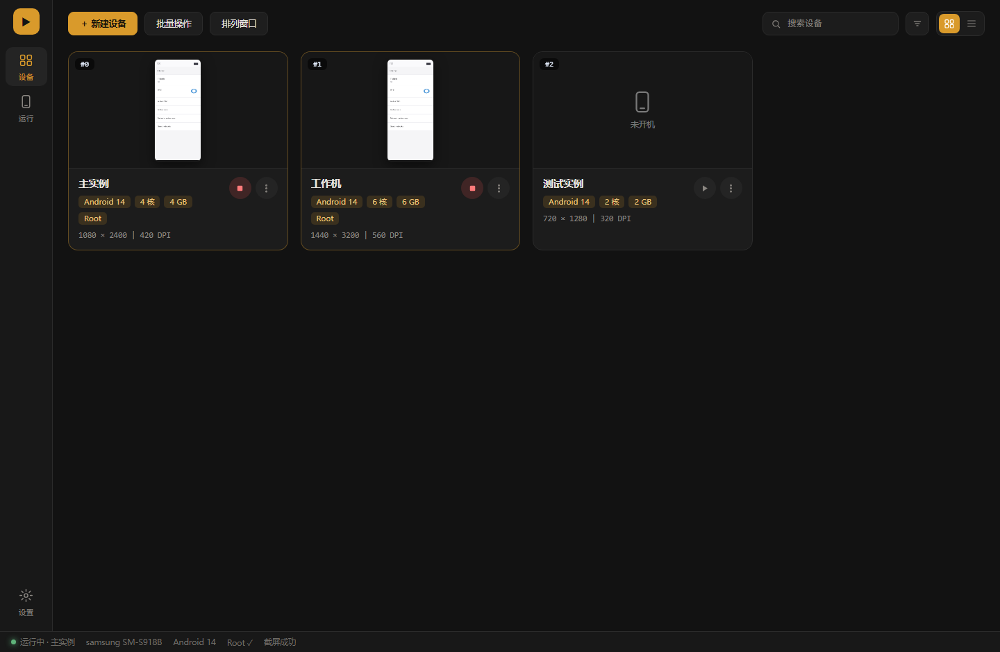
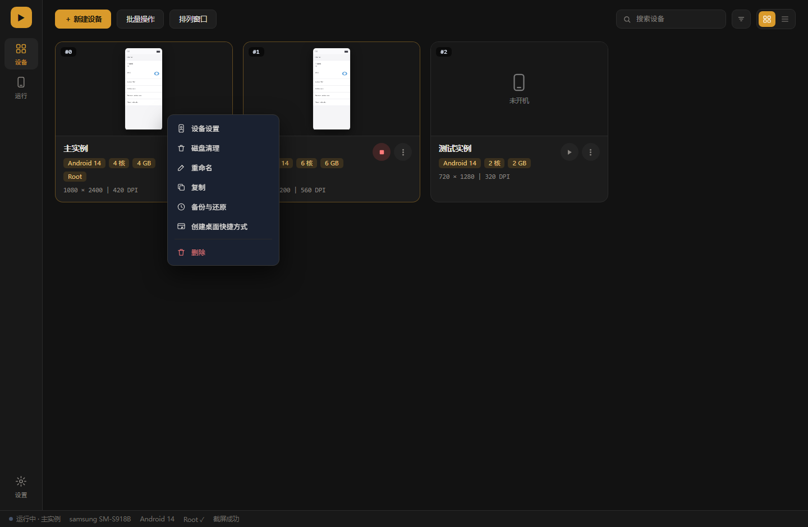
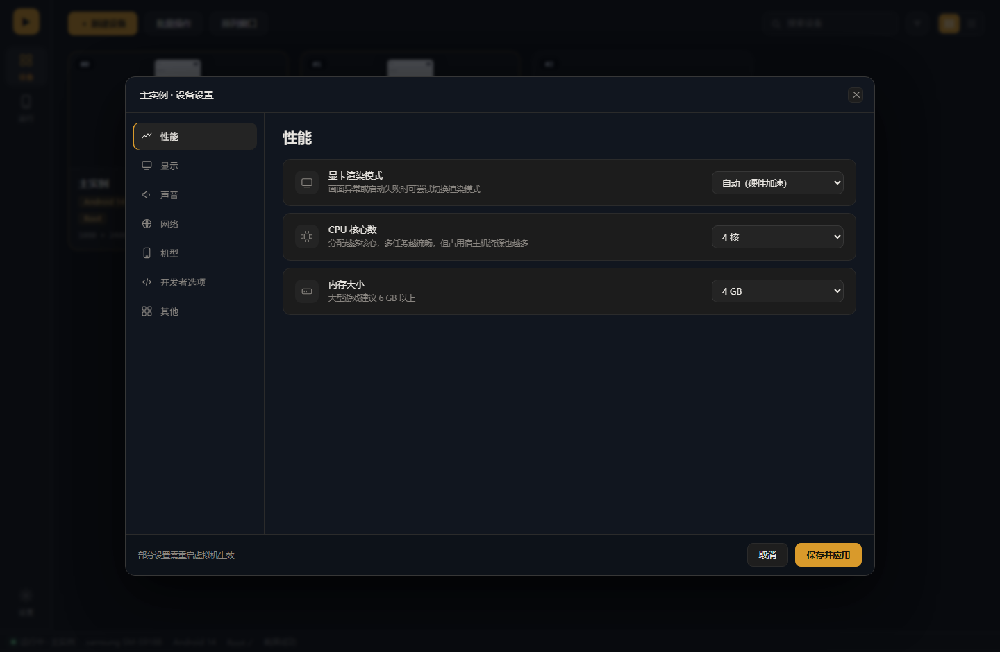
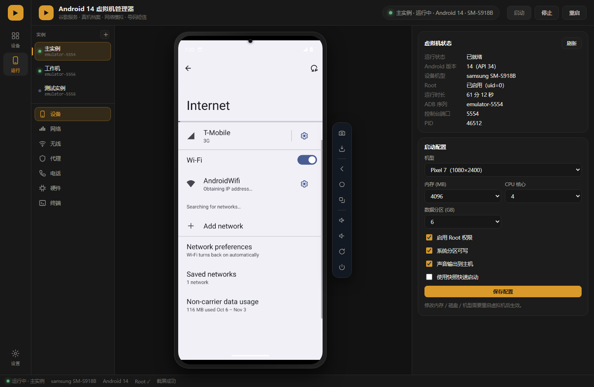

# Android 14 虚拟机管理器

基于 Android Emulator 的图形化管理器：**多开实例**、**真机档案伪装**、**网络/号码/短信模拟**、**Root**，界面按市面模拟器（BlueStacks / MuMu / LDPlayer）的布局重做。

[](https://github.com/NKBaa/androidvm-manager/releases/latest)
[](https://github.com/NKBaa/androidvm-manager/actions/workflows/build.yml)
[](LICENSE)

**下载**：[AndroidVM-Setup-1.0.0.exe](https://github.com/NKBaa/androidvm-manager/releases/latest)（安装版）
· [AndroidVM-Portable-1.0.0.exe](https://github.com/NKBaa/androidvm-manager/releases/latest)（便携版）



---

## 功能

### 设备列表（启动器）

界面参考 MuMu 模拟器的布局：左侧图标栏 + 设备卡片网格。

- **卡片网格**：每张卡显示序号、运行状态、Android 版本、核数、内存、分辨率 / DPI
- **实时缩略图**：运行中的设备每 10 秒抓一次真实截屏显示在卡片上
- **一键启停**：卡片右下角 ▶ / ■ 直接启动或停止，无需进入详情
- **搜索与排序**：按名称过滤，支持默认 / 名称 / 运行中优先三种排序
- **网格 / 列表**两种视图切换
- **卡片菜单**（右键或 ⋮）：

| 菜单项 | 说明 |
|---|---|
| 设备设置 | 打开完整设置弹窗 |
| 磁盘清理 | 清理设备内应用缓存 |
| 重命名 | 修改设备名 |
| 复制 | 以当前设备为模板新建一个 |
| 备份与还原 | 备份 / 还原数据分区，带流式进度条；还原前会检查虚拟机是否在运行 |
| 创建桌面快捷方式 | 在桌面生成带 `--instance=<id>` 的快捷方式，双击直接启动该设备 |
| 删除 | 删除设备及其数据 |



### 设备设置弹窗

左侧分区导航 + 右侧设置行，参考 MuMu 的设置面板：

**性能**（显卡渲染模式 / CPU 核心数 / 内存大小）· **显示**（分辨率 / DPI）·
**声音**（输出到主机 / 麦克风）· **网络**（网络场景 / 系统代理）·
**机型**（设备型号 / 真机身份）· **开发者选项**（Root / 系统分区可写 / 后台运行）·
**其他**（数据分区大小 / 快照 / 日志目录）



### 运行窗口

点设备卡片进入，左侧是设备预览，右侧是快捷设置面板：



### 系统托盘

关闭窗口后程序收进系统托盘，不退出：

- 单击 / 双击托盘图标 → 显示主窗口
- 右键 → 设备列表（每台可单独启动 / 停止）、打开数据目录、打开日志目录、退出
- 托盘图标加载失败时会自动跳过托盘，关闭窗口恢复为直接退出

### 多开实例
- 每实例独立 AVD、独立数据分区、独立端口（5554 / 5556 / …）
- 可同时运行多个实例，停止/重启/删除只作用于单个实例
- 新建实例自动克隆当前配置并分配空闲端口

### 真机档案（设备身份伪装）
- 内置 **Google Play 官方真机库**（54,328 台 / 3,879 个品牌）
- 一条命令写入 `brand / device / model / name / manufacturer` 与 `ro.build.*`，
  `ro.build.fingerprint` 会一并变化
- 可选 ARM ABI 伪装：把 `arm64-v8a` 提到 ABI 列表首位（`Build.SUPPORTED_ABIS[0]`），
  镜像自带 `libndk_translation.so`，ARM64 代码可真实执行

### 无线模拟
| 功能 | 状态 |
|---|---|
| 移动网络：信号/数据/语音/制式/漫游/运营商 | ✅ 完全可用 |
| 电话号码 / ICCID（双卡） | ✅ 完全可用 |
| 来电 / 短信注入 | ✅ 完全可用 |
| WiFi 开关 / 关联 / 状态（SSID·BSSID·RSSI） | ✅ 可用（无 IP，数据面依赖 netsim） |
| 蓝牙 | ❌ 底层 netsimd 无法启动，协议栈崩溃 |

### 网络与代理
- 10 种网络预设（2G/3G/4G/5G/WiFi/离线）+ 自定义带宽、延迟、丢包
- HTTP / HTTPS / SOCKS5 代理（自动把 `127.0.0.1` 映射为 `10.0.2.2`）

### 设备控制
- 悬浮侧边工具栏：截屏 / 安装 APK / 返回·主页·最近 / 音量 / 旋转 / 电源
- 显示分辨率、DPI、音量、摄像头、磁盘查看

### 摄像头
- 后置 / 前置分别配置：无、模拟画面、虚拟场景、**宿主机真实摄像头**
- 自动枚举电脑上的摄像头（`emulator -webcam-list` + WMI 兜底）
- 屏幕区域框选：抓屏 → 拖动选区 → 裁剪存为素材（实验性，见 [文档](_docs/摄像头.md)）

详见 [`_docs/摄像头.md`](_docs/摄像头.md)。

### 系统镜像
| 镜像 | GMS | 桌面 UI | 可 root |
|---|---|---|---|
| `google_apis`（推荐） | ✓ | ✓ | ✓ |
| `google_apis_playstore` | ✓ | ✓ | ✗ |
| `google_atd` | ✓ | ✗ | ✓ |

---

## 快速开始

### 方式一：安装包

下载 `AndroidVM-Setup-<ver>.exe` 或 `AndroidVM-Portable-<ver>.exe`（约 76 MB）。

安装包**不含 Android SDK**（约 5.4 GB），首次启动会自动查找 SDK；
找不到时界面顶部会出现橙色提示条，点「选择 SDK 目录」选中即可。

### 方式二：源码运行

```bash
git clone <repo>
cd app
npm install

# 准备 SDK（放到项目根目录 android-sdk/）
#   emulator + platform-tools + system-images;android-34;google_apis;x86_64

cd ..
start.bat
```

---

## 准备 Android SDK

**最简单：让程序自己下。**

首次启动若找不到 SDK，界面顶部会出现橙色提示条，点
**「在线下载 SDK（约 1.9 GB）」**，程序会从官方源或其镜像拉取并自动解压、校验 SHA-1，带实时进度条：

| 组件 | 下载大小 |
|---|---|
| `emulator` | ≈ 439 MB |
| `platform-tools` | ≈ 8 MB |
| `system-images;android-34;google_apis;x86_64` | ≈ 1491 MB |
| **合计** | **≈ 1.9 GB**（解压后 ≈ 5.4 GB） |

- **镜像源切换** —— 可选 Google 官方或腾讯云镜像（国内快 2 倍以上），两边清单的
  文件名 / 大小 / SHA-1 完全一致
- **断点续传** —— 中断后自动带 `Range` 头续传，不用从头下；续传完照常校验 SHA-1

下载器直接解析官方仓库清单 XML，所以**永远拿到最新版本**，不需要 Java / sdkmanager。

**也可以手动准备：**

用官方 `sdkmanager`：

```bash
sdkmanager "emulator" "platform-tools" "system-images;android-34;google_apis;x86_64"
```

或直接使用 Android Studio 的 SDK（程序会自动从
`%LOCALAPPDATA%\Android\Sdk` 找到），或设环境变量：

```powershell
$env:AVM_SDK_ROOT = "D:\Android\Sdk"
```

> **为什么 SDK 不打包进安装包？**
> 5.4 GB 超过 GitHub 单文件 2 GB 限制，也不适合放进仓库。
> 官方源下载最快也最新。

---

## 打包

```powershell
pwsh -File _tools\build.ps1
```

产物在 `dist\`：NSIS 安装程序 + 免安装便携版。
构建环境的坑位（TEMP 不可写、符号链接权限、代码签名）见
[`_docs/打包说明.md`](_docs/打包说明.md)。

---

## 目录结构

```
├── app/                  Electron 应用
│   ├── main.js           主进程 + IPC
│   ├── preload.js        安全桥
│   ├── renderer/         界面（HTML/CSS/JS）
│   ├── src/
│   │   ├── config.js     路径解析（源码/安装包两种形态）
│   │   ├── vm.js         虚拟机生命周期（按实例隔离）
│   │   ├── instances.js  多开实例注册表
│   │   ├── adb.js        ADB 封装（AsyncLocalStorage 多目标）
│   │   ├── deviceprofile.js  真机档案引擎
│   │   ├── wifi.js / bluetooth.js / cellular.js
│   │   ├── network.js / proxy.js / phone.js / device.js
│   │   └── reapply-cli.js    独立进程补应用档案
│   └── build/            图标、rcedit、afterPack 钩子
├── _data/                真机库 + 预置档案
├── _docs/                技术文档与截图
├── _tools/               构建 / 图标 / 界面预览脚本
└── start.bat             源码模式启动
```

---

## 已知限制（诚实说明）

| 项目 | 原因 |
|---|---|
| 蓝牙不可用 | 模拟器蓝牙依赖 `netsimd`，本机启动失败（Access denied），协议栈 abort 崩溃 |
| WiFi 拿不到 IP | 数据面（DHCP/slirp）同样依赖 netsim，但 L2 关联与 SSID/RSSI 可读 |
| 虚拟机内 DNS 解析失败 | 同样因为 netsimd 起不来，Android 没把 `eth0` 认成默认网络，主路由表没有 `default` 项，`ping` 报 `Network is unreachable` |
| 摄像头图片 / 屏幕区域模式 | 模拟器 37.3.5.0 上 `imagefile:` 会静默回退成「模拟画面」，三种路径写法都试过；实时跟随屏幕区域需要 Windows 虚拟摄像头驱动 |
| 虚拟场景摄像头 | 需要 GPU 实时渲染 3D，`-no-window` 后台模式会退化成合成图案 |
| 过不了 Play Integrity 硬件证明 | 无真实 TEE；`/proc/cpuinfo`、`ANDROID_EMU_*` GLES 扩展、`init.svc.qemu-*` 等仍会暴露 |
| ARM 伪装会让启动变慢 | ABI 改成 arm64 优先后系统库解析变慢，引导可能从 60 秒涨到 200~470 秒 |
| 长跑测试偶发 system_server 崩溃 | 本环境模拟器稳定性有限，跑满 40+ 项操作后偶发系统服务消失 |

详见 [`_docs/真机档案.md`](_docs/真机档案.md)、[`_docs/无线模拟.md`](_docs/无线模拟.md)、[`_docs/摄像头.md`](_docs/摄像头.md)。

---

## 测试

```bash
cd app

# 离线单测：SDK 下载器（含断点续传、镜像一致性）+ 摄像头纯函数，不需要模拟器
node run_unit_tests.js

# 完整 E2E：启动模拟器跑 42 项（含摄像头配置、实例注册表）
node -e "require('./run_tests').runE2E().then(n=>process.exit(n>0?1:0))"
```

E2E 报告写到 `_logs/test-report.txt`。

> 本机跑 E2E 时，「DNS 连通性」一项必然失败——这是 netsimd 起不来导致的环境问题，
> 不是代码缺陷。其余项若失败会附带具体原因。

---

## 许可

MIT
